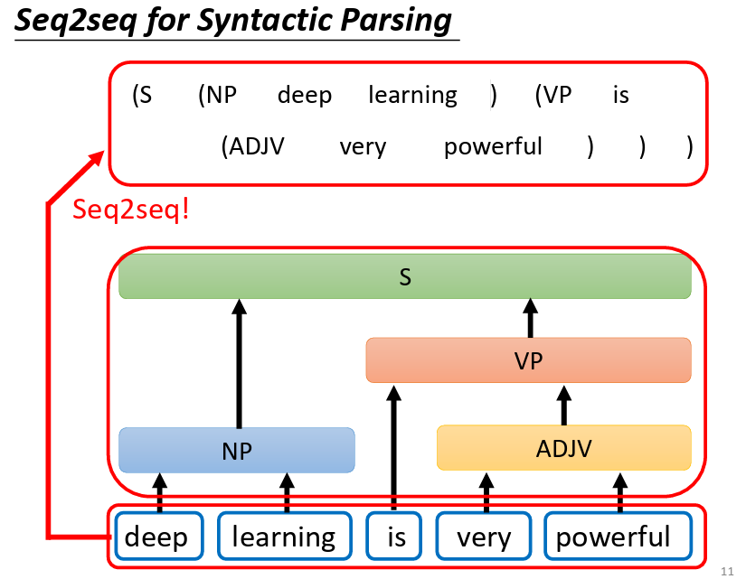
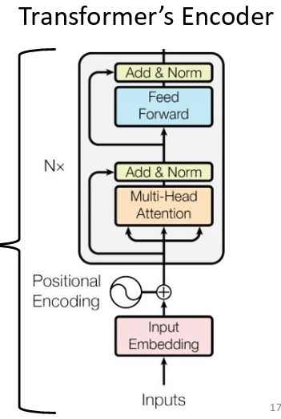
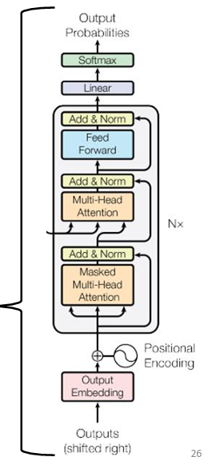
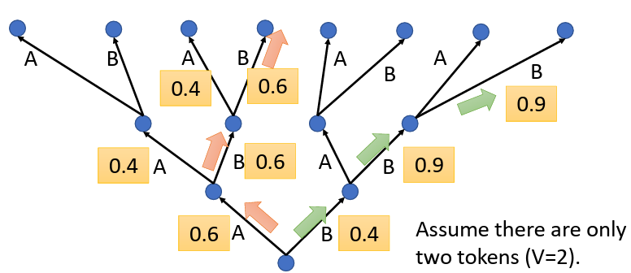
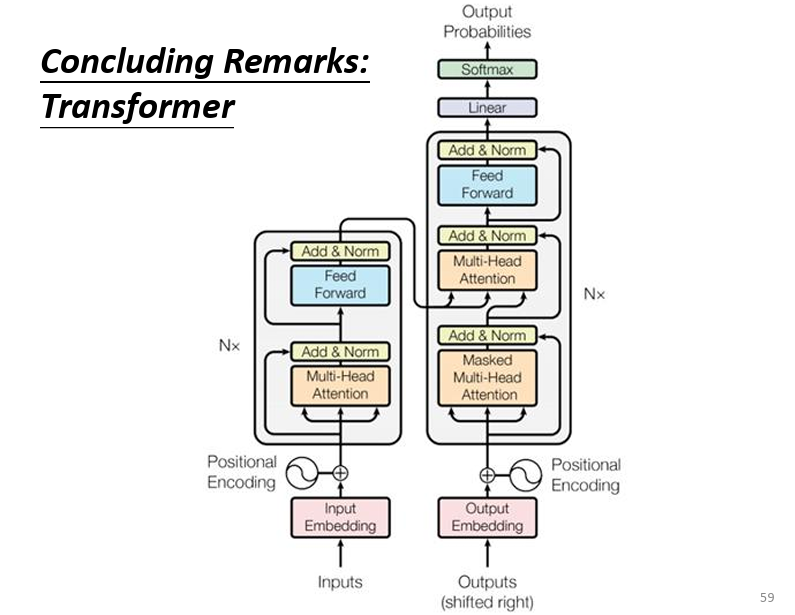

Transformer 是现代深度学习的基石架构，通过 Encoder-Decoder 结构实现强大的序列到序列建模能力。本文系统讲解 Transformer 的完整设计：从 Multi-Head Self-Attention 的并行特征提取，到 Masked Attention 的自回归生成，再到 Cross Attention 的编码器-解码器信息交互，以及残差连接、Layer Normalization、位置编码等关键技术的数学原理与工程实现。

> 延伸视频讲解：Hylee 2021 机器学习课程中关于 Transformer 的章节[^1]。

<!--more-->

## AI 总结

Transformer 通过 Encoder-Decoder 架构彻底革新了序列建模范式，将传统 RNN 的顺序依赖转化为可并行的全局注意力计算。本文从 seq2seq 任务的本质出发，深入剖析了 Transformer 的核心组件及其协同工作机制。

**Encoder 核心技术：**

- **Multi-Head Self-Attention**：通过 Query-Key-Value 三元组计算全局依赖关系，多头设计从不同子空间捕获语法、语义、指代等多维度特征
- **残差连接 (Residual)**：学习输入与输出的 " 差距 " 而非映射本身，梯度计算中恒有常数项 1，有效缓解深层网络梯度消失
- **Layer Normalization**：向量内部归一化避免变长序列 padding 干扰，确保每层输出稳定防止梯度爆炸
- **Feed Forward Network (FFN)**：512→2048→512 的升维思考机制，对上下文增强的向量进行非线性变换与特征整合

**Decoder 关键设计：**

- **Masked Self-Attention**：因果掩码确保位置 $i$ 的查询只能与 $\leq i$ 的键交互，保证自回归生成的时间一致性
- **Cross Attention**：$Q$ 来自 Decoder 前期输出审视历史，$K,V$ 来自 Encoder 的上下文表征，实现编码信息与解码状态的动态对齐
- **位置编码**：正弦余弦函数注入序列顺序信息，弥补注意力机制位置不敏感的天然缺陷

**训练与优化技巧：**

- **Teacher Forcing**：训练时用 ground truth 作为 Decoder 输入，配合 Masked Attention 并行计算整个序列的损失
- **Cross Entropy Loss**：每个 token 输出对应 vocabulary 上的概率分布，与 one-hot 标签计算交叉熵并平均
- **Copy Mechanism**：在摘要、问答等任务中，模型可在生成与复制原文之间切换，提高事实准确性
- **Beam Search**：维护前 $k$ 条最高累计对数概率路径，避免贪心解码的局部最优
- **强化学习对齐**：用 BLEU 等不可微指标作为 Reward，解决训练时依赖完美历史与推理时误差累积的 Exposure Bias 问题

**实践价值：**

Transformer 的 Encoder-Decoder 范式奠定了 BERT (Encoder-only)、GPT (Decoder-only)、T5 (Encoder-Decoder) 等预训练模型的基础，其核心思想——通过注意力机制实现全局信息聚合、通过残差与归一化保证训练稳定——已成为现代深度学习的标准组件。

## Seq2Seq 任务与 Transformer 定位

首先从形式上说， Transformer 是个 sequence to sequence 的模型，即输入是个序列，输出同样是个序列，而且输出序列的长度由模型自己决定，而不是我们预先设计。典型的 seq2seq 模型有，语音识别、机器翻译、语音翻译。

> 为什么对于声音输入，不把声音转换成文字，再从文字翻译输出到指定语种文字？因为有些语言，压根就没有文字，只有语音。这正体现了端到端（End-to-End）模型的威力，而 Transformer 就是实现这类强大 seq2seq 任务的经典架构。

> 在 2021 年的 hylee 老师的视频中，就提到了 nlp 问题中 QA 的范式 (参考文献来自 18、19 年)：question, context -> seq2seq -> answer。这与今天 llm 的 rag 和上下文管理，一脉相承。

很多问题看似与 seq2seq 无关，但经过巧妙地设计也可以转换为类似问题，用成熟的模型去解决。比如句法分析 - syntactic parsing，用文字和括号表示句法的树形结构，输出变成了特定格式的序列。

又比如多标签的分类，一个文档可以被打上不同的标签，我们就可以训练模型，输入为文档，输出就直接是其可能的标签，具体标签数量由模型自己决定。输入是一段新闻；输出直接生成 "#体育 " "#转会 " "#西甲 " 等标签序列），EOS 截止。训练时把标签按固定顺序/约定分隔符拼成目标序列。

_图片来自 [^1]_

Transformer 的架构正如其他 seq2seq 模型一样，由 Encoder 和 Decoder 组成。Encoder 的作用在于充分理解输入，并输出一种 internal representation 给 Decoder，Decoder 正是基于 Encoder 的输出和 Decoder 自己的逐步输出，autoregressive 进行输出，得到最后的 seq。

> 原始论文中的 Transformer 是 Encoder-Decoder 结构；后来像 GPT 等大模型多采用 Decoder-only（仅解码器）架构，但依然是序列生成。

## Encoder

Encoder 可以由 $n$ 个 block 进行叠加，在最初版本中 $n=6$。对于单个 block，主体由 multi-head self-attention layer 和 Feed Forward layer 组成，同时由 Layer Normalization 和 Residual connection 保证训练收敛。

input embedding + positional encoding -> Multi-Head Self-Attention -> Residual Add -> Layer Norm -> Feed Forward network -> Residual Add -> Layer Norm -> block output。

> 详细的 block 解释见下

_图片来自 [^1]_

这种架构只是原始的 Transformer，后面的讨论也专注于最原始版本，后来有更多的排列组合和改进优化。

### Residual

这是个天才的设计，使得训练 deep 神经网络成为可能。

在从前的 layer 设计中，input 通常是上一层的 output，这实际上是在这层网络学习一种 pattern - $\text{output}=F(x)$，其中 $x$ 为上一层的输出。

residual 的思想在于，这层 layer 的输出不仅仅是上层输入通过网络的结果，同时还有上一层的输入本身。$\text{output}=H(x)+x$，其中 $x$ 为上一层输入，$H(x)$ 为 residual 设计下 layer 需要学习的 pattern。

这就把学习的目标，从输入到输出的映射本身，变成了输入和输出之间的 " 差距 "，这使得学习变得容易。

更详细地说，这种设计由于加法的存在，梯度计算中总会有个 1，这就很大程度地缓解了深层网络梯度连乘可能造成的梯度消失。同时，由于我们总是直接保留上一层的输出，这也就意味着，随着网络层数的加深，我们的结果总是会变得越来越好，起码可以维持不变。

> 严格地说，性能并不一定会随着层数单调，还受到正则与优化等因素。

这解决了当网络层数加深，可能存在的退化问题。

### Layer norm

> Layer Norm 在每个样本的特征维度内做归一化，不依赖批次统计，天然适配变长序列与小批量；而 Batch Norm 依赖跨样本统计，遇到变长序列需 padding/掩码，且小批量时统计不稳，故 Transformer 通常采用 Layer Norm。

不同于 Batch Norm 关注的是每个 feature，即计算 batch 内每个 vector 相同位置元素 的 mean 和 std 并做标准化，Layer Norm 是 vector-wise 的，也就是计算每个 vector 内部的，元素之间的 mean 和 std 并标准化，与 batch 和 seq 均无关。

这种特点正是它被选择的理由。首先，对于 Transformer 这种 seq2seq 任务，每个 seq 的长度是可能不一样的。如果使用 batch norm 则需要按照最可能长度进行计算，并对不满足长度的 batch 进行 padding，而太频繁的 padding 引入 noise 会干扰特征的 std 和 mean 的计算，进一步损伤模型的训练和收敛 (尤其是在 batch 不够大，而 padding 占比过高时)。

而 Layer Norm 只关注 vector 内部，而每个 vector 必然是尺寸相同的。同时，Layer Norm 使得每个 block 和每个 layer 的输出都保持地很好，可以起到防止梯度爆炸或消失的问题。

### FFN

Multi-Head 相当于对每个 token 对应的 vector 做了上下文语义上的增强，此时的 vector 相比于输入时简单的 embedding 是 context richer，增加了对序列语义的了解和融合。此时，再把了解上下文的结果，送入到 FFN 中，进行 " 思考 "。

Feed Forward Network，这种叫法用于区别循环神经网络。在原始版本的 Transformer 中 $\text{FFN}(x)=\text{Linear}_{2}(\text{ReLU}(\text{Linear}_{1}(x)))$ ，其中 $W_{1}$ 为 $(d_{model}, d_{ff})$, $W_{2}$ 为 $(d_{ff}, d_{model})$，通常可能为形如 512 -> 2048 -> 512。以向量形式做解释，对于 context richer 的 vector $x$，左乘 $W_1$，将 $x$ 从 512 维放大到 2048 维，每一个元素，都是原始 $x$ 元素与权重的线性组合。这可以理解为，从 2048 个角度去思考 context richer 的 $x$，提供充足的思考方向。接着送入 $\text{ReLU}$，过滤一部分思考角度，再送入 $\text{Linear}_{2}$ 对于思考做进一步地加工整理，输出与输入维度相同的，例如 512 的 vector。

这就完成了，对于 self-attention 的 context richer 的向量，做扩充思考、过滤和整理输出的过程。把向量进行合适的拼接，就是实际中的矩阵形式，思想相同。

> 典型维度是 512→2048→512。先线性升维（扩展表示与计算容量），经非线性（如 ReLU/GeLU）筛选，再线性回投到 d_model，与残差对齐。

## Decoder

从整体上看，decoder 与 encoder 的架构差别不大，只有些细节需要说明。

_图片来自 [^1]_

### Mask

对于从 encoder 输出的 embedding，decoder 首先也要通过 Multi-Head self-Attention，不过是 masked 。这主要是为了适配按顺序输出和 auto-regressive 的设计。

在经典 self-attention 中，对于 $q_{1}$ 要找到并与所有的 $k$ 进行点积，但这显然不符合 seq 逐个 token 输出的形式。所以，mask 就是遮住未出现的元素，对于 $q_{i}$ 只与之前的 $k_{j}$ 进行点积，计算 attention 进而计算 $b_{i}$，其中 $i\geq j$。

> 解码器使用因果（Causal）Mask：位置 i 的查询只与 ≤i 的键交互，确保按时间步自回归生成；训练时用右移的 " 教师信号 "，推理时用模型自己刚生成的历史。

这也正是 auto regression 的形式，decoder 的当前输出，基于 decoder 之前的输出以及 encoder 送过来的输出。另外，也需要一个特殊的字符来表示 start，用于当做 auto regression 的 decoder 的初始值。

由于需要模型学习输出序列的长度，所以在 output 的 vocabulary table 中，会多出一个特殊的字来表示 end。当模型输出 end 之后，就截断后面的输出，并返回 end 之前的输出。

> 有 auto regression -AT 形式的 decoder，就有 NAT - not auto regressive 形式的 decoder。它一次性输出所有的 output，而不是一个一个 token 的吐出，但通常情况下的输出效果要差于 AT，同时训练难度也高于 AT，其优势就在于输出速度快和计算资源少。

### Cross Attention

与 self-attention 很像，只是 $Q,K,V$ 的来源有所变化。原始 self-attention 中，$Q,K,V$ 均来自序列本身。

而 Cross Attention 中，$q$ ，以向量为例，是 Musked Self-Attention 的输出，即考虑了所有前期输出，而 $K,V$ 来自 Encoder，即处理过的 context richer 的向量。

这就好比如，Decoder 在输出下一个字的时候，通过 Musked Self-Attention 审视之前所有的输出，然后在 Encoder 处理过的 context richer 中寻找与当前向量最相关的 $k$，并加权 $v$ 得到新的输出，再传递给 FFN。

正是这种机制，将 Encoder 处理过的出输入 seq 和 Decoder 的前期输出相链接，保证 Decoder 的输出，即考虑到了前期的输出，也时刻与 Encoder 中的最相关部分保持链接。

> 自然如其他各个 layer 和技术一样，cross attention 也有各种变体。

## Training

### Cross Entropy & Teacher Forcing

从本质上讲，模型的输出是个分类问题。每个输出都是在整个 vocabulary 表中选择一类进行输出。自然可以用 cross entropy 进行 loss 的描述。

由于 seq 输入和 autoregression 输出的性质，cross entropy 的计算细节上有些不同。在训练中，我们通常计算整个 batch 的 avg loss。

而由于 auto regression 的特点，我们为了并行化计算，我们的 decoder 是同时计算所有结果的。故使用了 mask self attention 来保证只能看到前面的输入。

请注意，这里 " 前面的输入 " 是 ground truth 的，即模型前一步的理想输出（label）。这时 decoder 的输出，可以看做是，当前面都完美输出时，当前时刻的输出。这种设计，有个名字叫 Teacher Forcing。

在训练的计算中，我们一次性计算整个 batch 的输出，展平，并与理想的 label 进行比较，计算 cross entropy，再平均得到整个 batch 的表现。

从理论上说，我们是计算了每个模型输出 token 的 loss。模型单个 token 的输出，是个尺寸等于 vocabulary table 的 prob distribution（利用 softmax 从 logit 到 prob），与 one-hot vector 形式的理想 token 进行比较，计算 cross entropy，并得到当前 token 的 loss。

## Other Tips

- Copy Mechanism - 在很多实际任务中，比如打招呼、summary 等，我们期待模型具有复制输入到输出的能力，尤其是在出现未知内容的时候，模型应该会复制未知内容，请求 user 详细解释
  - Copy/Pointer 机制常用于含大量专名/OOV 的任务（摘要、问答），在生成与指向原文片段之间切换，提高事实与可读性。
- Beam Search - 把模型的所有可能输入想象为一棵具有大量分支的树，如果我们每次选择当前 token prob dist 对应最大进行输出，就是贪心的。另外还有种可能，是当我们计算多步的总 prob 的时候，会有非贪心路径脱颖而出，当然我们不可能检查一个 batch 中的所有可能路径，这就需要有别的更合适的技术。
  - Beam Search 维护前 k 条最高的累计（对数）概率路径，并常用 ' 长度归一化 ' 避免过短序列的概率偏置。

- Sampling - 在有些情况下，我们发现，给 decoder 添加一些噪声，结果的表现反而会更好。典型的例子如创意续写，如果 decoder 没有噪声，在某个时刻之后，它可能会进入自我重复循环，因为这种方式的 loss 是最小的。添加一些噪声之后，我们从输出结果上观察，反倒表现会更很好。
- Reinforcement learning - 模型在训练过程中，关注的是如何降低 cross entropy，而 loss 的计算依赖于一个重要的前提假设，模型输出的 token 是基于绝对正确的前期输入 label。这个假设在 inference 中是不存在的。这就引入了潜在的风险，一旦模型在 inference 的过程中，出现了对于标准结果的偏离，后续的输出有可能完全跑偏。那么如何衡量作为一个整体的模型输出呢？可以使用例如 BLEU 等方法，衡量模型输出与理想结果之间的相似性。更进一步，BLEU 之类的指标无法用在类似 Transformer 的架构中作为 loss 函数，这是因为它完全不可微分，也就无法使用基于梯度的一系列优化器。那么针对这种情况，对于一切不可微分的衡量标准，一个通用的办法是，利用强化学习，将这种 metrics 作为 reward 处理。

## 全景

## 参考文献

[^1]: <https://speech.ee.ntu.edu.tw/~hylee/ml/ml2021-course-data/seq2seq_v9.pdf>
